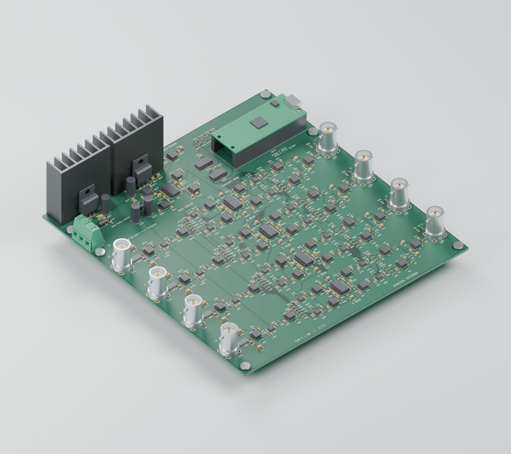
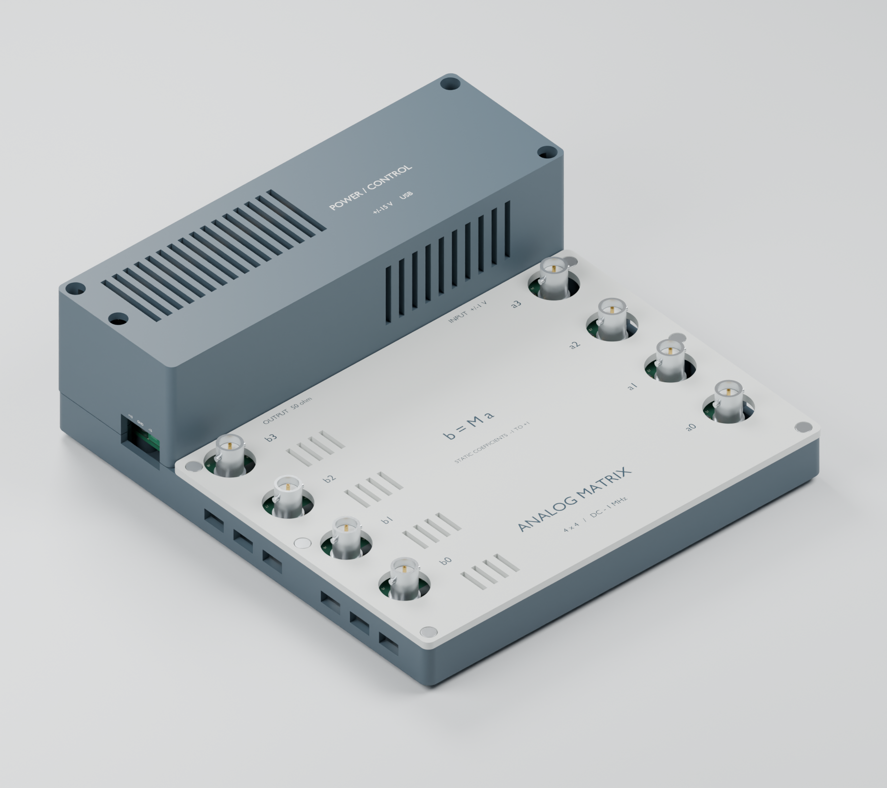

# Analog Programmable Matrix

A four-input, four-output, DC-coupled analog matrix for programmable addition, subtraction, and signal mixing. A Raspberry Pi Pico sets sixteen static signed coefficients over USB; the signals remain in the analog domain.

$$b_i = \sum_{j=0}^{3} M_{ij}a_j, \qquad -1 \leq M_{ij} \leq 1$$

This first public version contains **PCB D and enclosure M3**, without the added power-indicator LED. It is an **unbuilt prototype**: the 1 MHz bandwidth and approximately 1% gain accuracy are design targets supported by circuit simulations, not measured hardware specifications.

## PCB and enclosure

These are renders generated from the CAD, not photographs of manufactured hardware.





[Exploded enclosure render](mechanical/analog_matrix_package_m3/renders/enclosure_exploded.png) · [Dimensioned drawing](mechanical/analog_matrix_package_m3/mechanical_dimensions.png)

## Design at a glance

| Item | Design |
| --- | --- |
| Matrix | 4 × 4, independently programmable signed coefficients |
| Signal range | DC through 1 MHz target; ±1 V peak per input |
| Inputs | Four vertical BNCs; high impedance by default |
| Outputs | Four vertical BNCs; up to ±4 V peak **into an external 50 Ω load** |
| Output termination | 49.9 Ω series source resistor; a high-impedance receiver sees approximately twice the loaded voltage |
| Coefficient control | 16-bit multiplying DACs and analog polarity switches |
| Controller | Original Raspberry Pi Pico, MicroPython, USB serial JSON commands |
| Supply | External regulated ±15 V plus USB for the Pico; onboard ±5 V analog regulators |
| PCB | 160 × 170 mm, four copper layers, nominal 1.6 mm FR-4 |
| Enclosure | 180 × 192 × 60 mm; 62.5 mm including feet |
| Cooling | Two 38.1 mm heatsink envelopes; passive ventilation |

## How it works

The input amplifiers generate buffered positive and negative versions of each input. Each matrix cell selects a polarity with a TMUX6219 and sets its magnitude with an AD5544 multiplying DAC and ADA4899-1 transimpedance stage. A summing amplifier combines the four contributions for each output, followed by a THS3091 driver and a 49.9 Ω source resistor. A fifth AD5544 supplies four offset-trim controls.

The Pico changes DAC codes and switch states; it does not digitize or synthesize the waveform. Firmware starts with the outputs muted and temporarily mutes them during coefficient changes. Coefficient and offset calibration are performed through USB commands.

## Open the design

- [KiCad project](pcb/analog_matrix_4x4_rev_d/analog_matrix_4x4.kicad_pro) — open with KiCad 8.0.6 or newer. Keep the included local libraries beside it.
- [Schematic PDF](pcb/analog_matrix_4x4_rev_d/schematic.pdf) — nine sheets: inputs, four output rows, trim, control, power, and index.
- [Firmware and USB protocol](pcb/analog_matrix_4x4_rev_d/firmware/CONTROL.txt).
- [Fabrication and bring-up notes](pcb/analog_matrix_4x4_rev_d/FABRICATION_AND_BRINGUP.txt).
- [Enclosure assembly instructions](mechanical/analog_matrix_package_m3/ASSEMBLY_AND_PRINTING.txt), [STLs](mechanical/analog_matrix_package_m3/print), and [STEP enclosure parts](mechanical/analog_matrix_package_m3/cad).
- [JLCPCB upload files](output/jlcpcb_rev_d) and [procurement status](docs/JLCPCB_ORDER_STATUS.md).

The [Releases page](https://github.com/tim4431/analog_programmable_matrix/releases) contains ZIP downloads, including the complete populated-board and enclosure STEP assemblies. The two large assembly STEP exports are distributed there rather than duplicated in Git.

## Set a matrix

Install the supplied `firmware/main.py` on the original Pico running MicroPython. Apply the analog supplies before USB power, then send newline-terminated JSON commands over the Pico's USB serial console:

```json
{"cmd":"set","matrix":[[1,0,0,0],[0,1,0,0],[0,0,1,0],[0,0,0,1]]}
{"cmd":"arm"}
```

Rows select outputs and columns select inputs. For example, `[0.5,-0.5,0,0]` makes that output half the difference between the first two inputs. Use `{"cmd":"mute"}` to mute the outputs and `{"cmd":"status"}` to read the current state.

The initial gain scale is an estimate. Follow the [calibration procedure](pcb/analog_matrix_4x4_rev_d/firmware/CONTROL.txt) to measure both coefficient signs and each row's offset with the intended 50 Ω loads.

## Validation and limits

The supplied checks report zero KiCad schematic errors, PCB design-rule violations, unrouted connections, or schematic/PCB mismatches. Nominal enclosure collision checks pass, and all three printable parts are watertight, single-shell meshes. The [BNC access review](mechanical/bnc_access_review_no_led/BNC_ACCESS_REVIEW.txt) checks all eight straight-plug positions; the two beside the raised hood need a side grip.

[Circuit-level SPICE results](pcb/analog_matrix_4x4_rev_d/circuit_spice_validation_A2.pdf) show about 0.758% gain reduction at 1 MHz after DC normalization and approximately 119 ns settling to 1% in the nominal row model. Read [MODEL_SCOPE.txt](spice/MODEL_SCOPE.txt): the multiplying-DAC model is approximate, parts of the full-row test are idealized, and the 1 nF load transient remains unresolved. These results do not establish 1% relative accuracy at small coefficients or validate PCB parasitics.

Thermal testing is still required. The analog circuit dissipates roughly 10 W at idle; each ±5 V regulator loses roughly 3 W. The modeled heatsinks are clearance envelopes, not qualified purchased parts. Follow the [thermal calculation and first-article acceptance procedure](mechanical/analog_matrix_package_m3/THERMAL_CALCULATION.txt) before sustained operation.

## Manufacturing

The assembly export contains 406 fitted SMT components, 18 separate through-hole/module items, and four intentionally unpopulated input-termination resistors. Upload these files to JLCPCB:

1. [Gerber_JLCPCB.zip](output/jlcpcb_rev_d/Gerber_JLCPCB.zip)
2. [BOM_JLCPCB.csv](output/jlcpcb_rev_d/BOM_JLCPCB.csv)
3. [CPL_JLCPCB.csv](output/jlcpcb_rev_d/CPL_JLCPCB.csv)

Supplier matching is incomplete. Do not treat the six existing LCSC identifiers as reserved assembly inventory. Check every selected part's package and pin-1 orientation, and obtain CAM acceptance for epoxy-filled/copper-capped via-in-pad fabrication, including the 0.20 mm thermal holes. The [handoff notes](output/jlcpcb_rev_d/START_HERE.txt) describe the exact stack, drill and placement conventions.

The requested initial build is **two assembled boards**. No order has been submitted or paid.

## Reproduce checks and CAD

Run `python tools/verify_release.py` to verify the stored design hash, check reports, BOM/CPL references, and simulation netlist evidence. It checks the delivered files; it does not rerun SPICE or physical tests.

For fresh electrical checks, use KiCad's `kicad-cli sch erc` and `kicad-cli pcb drc --schematic-parity` on the project. The scripts in the project's `tools/` directory compare symbol pins, footprints, and the exported netlist.

Mechanical sources are `mechanical/analog_matrix_package_m3/build_package.py` (CadQuery 2.8) and `render_package.py` (Blender 4.3). The included geometry, models, and PCB texture allow the current assembly and renders to be regenerated. The auxiliary export scripts use KiCad's Python environment and Windows installation paths, which may need adjustment on another system.

Final simulation benches and their recorded results are retained under `spice/`. Manufacturer macromodel downloads are excluded from Git; use `python spice/fetch_models.py` with TI's model downloads and a local LTspice installation, then `python spice/replay.py --bench a2_row_sine_rc.cir`. See [simulation setup](spice/README.md).

## Third-party material

KiCad footprint/model licensing and attribution are included beside the libraries. TI and Analog Devices simulation models retain their manufacturers' terms and are not covered by any implied project-wide license. See [third-party notices](docs/THIRD_PARTY_NOTICES.md). A project-wide license for the original design has not yet been selected.
