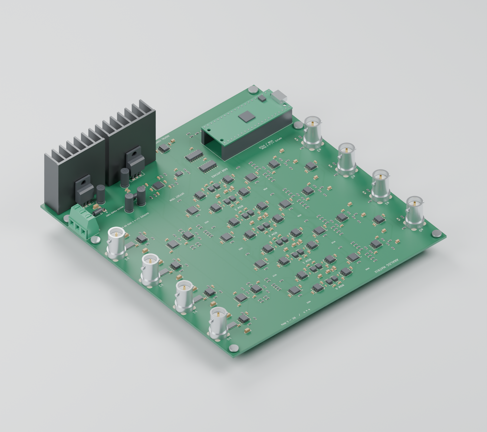
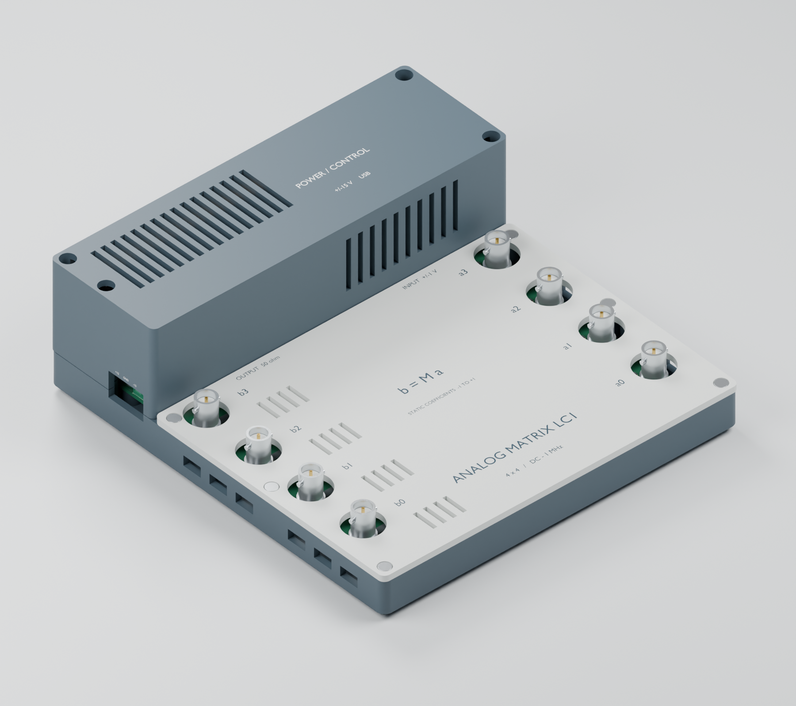

# LC1: lower-cost 12-bit analog matrix

LC1 is a separate four-input, four-output programmable analog matrix. It keeps the DC–1 MHz, ±1 V input and ±4 V output into 50 Ω targets of [Revision D](../../pcb/analog_matrix_4x4_rev_d), using less expensive multiplying DACs and more dual/quad packages. Revision D remains available unchanged.

**This is an unbuilt prototype, not a measured 1% instrument.** The nominal circuit simulations meet the amplitude-flatness target, but the cheaper DAC's bandwidth is a typical specification. Actual boards need qualification. Use the LC1 PCB, BOM and firmware together; the parts are not drop-in replacements on Revision D.

## Design changes

Quantities below are per board.

| Function | Original Revision D | LC1 |
| --- | --- | --- |
| Matrix multiplying DACs | 4 × AD5544, 16 bit | 16 × DAC7811, 12 bit |
| Offset DAC | 1 × AD5544 | 1 × MCP4728 |
| Input and summing amplifiers | 16 × OPA810 | 8 × OPA2810 dual |
| Polarity and mute switches | 20 × TMUX6219 | 10 × TMUX6136 dual |
| Offset amplifiers | 4 × OPA197 | 1 × OPA4197 quad |
| Current-to-voltage amplifiers | 16 × ADA4899-1 | Same |
| 50 Ω output drivers | 4 × THS3091 | Same |
| IC packages, including controller/regulators | 71 | 62 |
| Total listed components, including 4 DNP resistors | 428 | 387 |

That is **41 fewer components and 9 fewer IC packages** overall, even though the economical matrix DACs are single-channel devices. The fast current-to-voltage stages and high-current output drivers are retained to avoid a much riskier signal-path simplification. Connector clearances, 160 × 170 mm outline, power inlet, mounting holes and the existing [M3 enclosure](../../mechanical/analog_matrix_package_m3) are retained. The board is not thermally requalified by this revision; use the original insulated heatsinks and ventilation.

## Files

- [KiCad project](hardware/analog_matrix_lc1.kicad_pro), [schematic PDF](hardware/schematic.pdf), [PCB](hardware/analog_matrix_lc1.kicad_pcb).
- [Simulation review PDF](simulation/report/LC1_simulation_review.pdf), [recorded results](simulation/results.json), [model limitations](simulation/MODEL_SCOPE.txt).
- [LC1 Pico firmware](firmware/main.py) and [control/calibration instructions](firmware/CONTROL.md).
- [Gerber ZIP](assembly/Gerber_JLCPCB_LC1.zip), [SMT BOM](assembly/BOM_JLCPCB.csv), [placement file](assembly/CPL_JLCPCB.csv), and [assembly instructions](assembly/START_HERE.txt).
- [Purchasing comparison and sourcing limitations](SOURCING.md).

## PCB and shared enclosure

These CAD renders show LC1's component population in the existing M3 enclosure; they are not photographs or proof of electrical performance.

[Exploded view](mechanical/renders/enclosure_exploded.png) · [Mechanical clearance checks](mechanical/mechanical_checks.json)

## Electrical operation

Each input is buffered and split into matched positive and negative paths. A TMUX6136 channel selects polarity, a DAC7811 sets magnitude, and an ADA4899 converts the DAC current to a voltage. Four weighted voltages enter each row summer. A muted/unmuted output stage drives a 49.9 Ω series resistor and the external 50 Ω load.

Inputs are high impedance. The quoted output amplitudes require **an external 50 Ω termination**; a high-impedance receiver sees approximately twice that voltage. Analog ±15 V power and USB are both required. Apply analog power before USB; USB ground is common with signal ground.

The multiplying DACs are genuinely multiplying converters, so negative and positive DC inputs remain valid. An inexpensive ordinary voltage-output DAC is used only for DC offset correction. Twelve-bit coefficient magnitude steps are approximately 0.026% after gain headroom. Calibrate positive and negative gain separately for every matrix entry. Small-coefficient relative error and deep cancellation are not specified.

The TMUX6136 uses ±15 V supplies, with 120 Ω typical on resistance included in the model. Calibration absorbs its static attenuation. Compensation is 1.0 pF C0G ±0.1 pF at each ADA4899; the model includes additional stray capacitance. Row summing feedback is 549 Ω, providing coefficient calibration headroom.

The MCP4728 uses its internal 2.048 V reference and gain of one. OPA4197 stages invert and filter its outputs with 10 kΩ/10 nF feedback. Trim code 2500 gives approximately −1.25 V at a trim amplifier. Nominal loaded output trim is about 55 µV/code; the output correction range is approximately −138 to +88 mV, before individual device offsets.

## Validation and limits

The schematic passes KiCad ERC and an independent pin-to-net comparison with zero errors. The routed PCB passes native DRC with **zero violations, zero incomplete connections and zero schematic mismatches**. Gerbers, BOM and placements are checked against the released PCB hash. [Recorded checks](assembly/assembly_checks.json)

The inner ground layer has one continuous filled region and carries no routed signal or power tracks. All 16 DAC current-output connections stay on the top layer, have no vias, and are approximately 5.16 mm long. Power traces were widened where clearance allowed; local pin escapes remain narrower. [Layout review](hardware/layout_review.json)

Host firmware tests cover bit ordering, DAC commands, startup muting, input validation and bus-error muting. The simulation report contains 35 completed, hash-checked cases:

- Nominal 1 MHz magnitude droop: 0.70% positive, 0.72% negative.
- Modeled resistor/capacitance corner: 0.86% droop.
- Minimum modeled feedback phase margin: 57.5°.
- Full four-input step settles within 1% in about 118 ns (50 Ω + 20 pF) or 181 ns (50 Ω + 1 nF).
- A deliberately reduced 5 MHz DAC-bandwidth assumption produces 2.15% droop and **fails** the 1% target.

These are circuit-model results. DAC bandwidth and switches use simplified models, and PCB parasitics, crosstalk, noise, temperature drift and power sequencing are not fully modeled. Do not treat the 35 completed cases as a claim that all hypothetical corners meet specification.

## Reproduction

The released KiCad files are the editable design. `tools/build_design.py` derives LC1 schematic sheets from the unchanged original; `tools/build_board.py` produces a placement/routing seed, **not a finished routed board**. Do not run the seed generator over a routed PCB you wish to keep.

Circuit models are intentionally excluded from Git where vendor licenses apply. Fetch the original amplifier models with `../../spice/fetch_models.py`, then use `tools/fetch_models.py` for LC1-specific models. Run `tools/simulate.py` with LTspice installed. `tools/test_firmware.py` tests the LC1 firmware without a physical Pico. `tools/make_report.py` consumes the recorded raw files and requires NumPy, Matplotlib and ReportLab.

Run `python variants/lc1/tools/verify_release.py` from the repository root to check the stored release evidence, source hashes, manufacturing exports and firmware. This does not rerun SPICE or replace hardware qualification. The existing Revision D JLCPCB order was not changed; LC1 needs its own quote and part matching.

See the original repository license. Imported KiCad libraries retain their separate library license.
